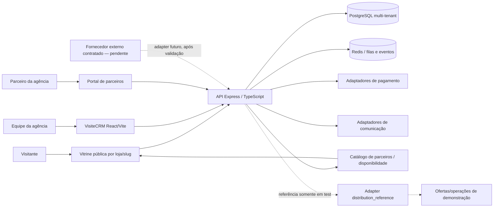

# Diagnóstico Fase 0 — Marketplace turístico Visite Cariri

- **Data:** 19 de outubro de 2026
- **Versão:** 1.0
- **Situação:** concluído para validação do responsável; nenhuma implementação autorizada
- **Fontes externas consultadas:** 23 páginas oficiais ou primárias
- **Escopo:** capacidades atuais do VisiteCRM, alternativas open source selecionadas, arquitetura, relações de dados, permissões, riscos e backlog de validação/entrega.

## Resumo executivo

**Recomendação:** estender o VisiteCRM existente, mantendo o monólito modular e seus limites por tenant. Não há evidência suficiente para substituir o CRM por uma plataforma de comércio ou turismo. O sistema já contém a base de vitrine por agência, catálogo, checkout, reservas, pagamentos, produtos de parceiros, disponibilidade datada, portal de parceiros, comissões e registros contábeis de liquidação. Esses componentes reduzem o trabalho de uma primeira oferta regional, mas não provam que exista um marketplace regional multiforncedor operando em produção.

A lacuna determinante é a operação externa. O adaptador `distribution_reference` é uma implementação de demonstração, fixa o ambiente em `test` e fornece ofertas e operações simuladas. A API expõe um catálogo público marcado `testOnly`, mas não foi encontrado um cliente do marketplace no frontend que o use para concluir uma compra. Nenhuma integração com fornecedor externo, transação, cancelamento ou repasse foi confirmada em produção. O portal de parceiros já existente é um fluxo por agência/tenant e não equivale a um canal regional independente.

Antes de qualquer desenvolvimento, o responsável precisa confirmar o documento-base, se o produto será um catálogo regional único ou uma rede de lojas isoladas por agência, quais parceiros/provedores estão ativos e quais regras comerciais estão aprovadas para disponibilidade, cancelamento, comissão, pagamento e repasse. O inventário de código não resolve essas decisões. A decisão também afeta quem será dono do catálogo, da reserva e do dinheiro em um pedido com vários fornecedores.

Entre as alternativas pesquisadas, Medusa é a opção mais próxima de um framework de comércio extensível, mas sua receita oficial de marketplace exige módulos, autenticação de fornecedores, rotas, painéis e divisão de pedidos construídos pelo implementador [[1]](https://github.com/medusajs/medusa) [[2]](https://github.com/medusajs/medusa/blob/develop/LICENSE) [[3]](https://docs.medusajs.com/resources/recipes/marketplace). Travelly (MagePeople Tour Booking Manager) e QloApps atendem recortes de reservas de excursões e hospedagem, respectivamente, mas introduziriam outra aplicação, outro ciclo de pedidos e obrigações de licença a revisar [[8]](https://raw.githubusercontent.com/Qloapps/QloApps/develop/README.md) [[11]](https://opensource.org/licenses/OSL-3.0) [[13]](https://github.com/magepeopleteam/tour-booking-manager) [[14]](https://www.gnu.org/licenses/old-licenses/gpl-2.0.html) [[15]](https://wordpress.org/plugins/tour-booking-manager/). TourApp não tem licença verificável na árvore consultada e sua atividade visível é antiga [[4]](https://github.com/tourapp/tourapp) [[6]](https://github.com/tourapp/tourapp/commits/master) [[7]](https://github.com/tourapp/tourapp/blob/master/LICENSE). OpenTripPlanner é um planejador de transporte público; OpenTravel é um conjunto de padrões e ferramentas, não um marketplace pronto [[18]](https://github.com/opentripplanner/OpenTripPlanner) [[20]](https://docs.opentripplanner.org/en/dev-2.x/) [[22]](https://opentravel.org/) [[23]](https://github.com/OpenTravel/).

Este relatório é somente documental. Nenhum código funcional, schema, migração, dado, integração ou ambiente de produção foi alterado; nenhum segredo foi lido. A validação técnica da workspace foi parcial: os typechecks de API e VisiteCRM e o `schema-drift` concluíram, mas o workflow da API falhou ao iniciar, e um teste de checkout falhou em uma expectativa de erro. Esses pontos estão registrados como bloqueios de verificação, não foram corrigidos dentro da Fase 0.

## 1. Objetivo, método e limites

O objetivo desta etapa é responder se a plataforma deve estender, complementar ou substituir partes do CRM antes de iniciar uma implementação. O trabalho separou quatro níveis de evidência: **código presente**, **comportamento coberto por teste**, **configuração conectada** e **operação real confirmada**. A presença de uma tela, configuração ou rota não é tratada como prova de que um parceiro, gateway ou fluxo está ativo.

O documento-base referido na tarefa não foi localizado após busca ampliada por arquivos e conteúdo no workspace, incluindo documentação, tarefas, código e pesquisas. Isso não prova que o documento inexista fora do workspace. O responsável deve indicar o arquivo aprovado ou confirmar que esta Fase 0 deve seguir sem ele.

Este diagnóstico não repete as auditorias de segurança já registradas. A auditoria de 15 de outubro inventariou famílias de rotas privadas, guards e riscos de tenant; a matriz do mesmo dia resume escopo e cobertura por família. A auditoria direcionada de 17 de outubro tratou de loja, pagamentos, finanças, indicações e reservas, e declarou limites em transições e relações ainda não integralmente revisadas. Este documento acrescenta a análise de adequação de produto para marketplace, alternativas, integração de distribuição e decisões operacionais. Deve ser lido junto de:

- `docs/audits/2026-10-15-auditoria-tecnica-etapa-1.md`
- `docs/audits/2026-10-15-matriz-rotas-privadas.md`
- `docs/audits/2026-10-17-auditoria-etapas-3-4.md`
- `docs/arquitetura-hospedagens-dois-modos.md`

As páginas de produto, repositórios e changelogs externos são fontes primárias para o que cada projeto declara, mas não são avaliações independentes de desempenho, suporte, segurança operacional ou adoção. A comparação não faz afirmações de participação de mercado. Alertas do NVD discutidos abaixo atribuem os dados a terceiros e não equivalem a uma confirmação independente do estado atual de correção.

## 2. Inventário de capacidades existentes

| Área | Evidência no VisiteCRM | Cobertura observada | Configuração/uso real |
|---|---|---|---|
| Vitrine e catálogo | `stores`, `store_products`, catálogo público por slug e páginas da vitrine | Há testes de API e componentes; a execução focada desta auditoria terminou com 96 de 97 testes passando | Não foi feita compra real nem inspeção de conteúdo publicado |
| Produtos de viagem e hospedagem | Produtos da loja podem apontar para viagem; há módulos de reservas e dois modos de vínculo entre viagem e hospedagem | A auditoria de 17/10 cobre amostras de loja/reservas, não todas as transições ou o schema integral | Não se confirmou inventário externo de hotel ou fornecedor |
| Parceiros e fornecedores | `partners`, `partner_products`, `partner_availability` e `partner_commissions`; catálogo do parceiro pode ser associado a um produto da loja | Rotas de parceiro e portal existem; escopo de tenant/parceiro está codificado | Nenhum parceiro foi validado operacionalmente nesta rodada |
| Checkout e reservas | Pedido e itens da loja; criação de reservas vinculadas a produtos de viagem; chaves de idempotência e verificações no servidor | Testes direcionados existem; um teste atual falhou na prioridade de validação do limite de assentos | Nenhuma transação de pagamento foi executada |
| Pagamentos | Código para caminhos de pagamento e confirmação do servidor, incluindo Stripe e InfinitePay; há trilhas legadas/documentadas para outros provedores | Revisão direcionada anterior cobriu partes do fluxo; não equivale a uma matriz completa de estorno, chargeback e concorrência | Integrações instaladas na workspace não comprovam credenciais, conta ou uso pelo app. Nenhum segredo foi consultado |
| Liquidação e comissões | `settlement_items` captura valores por item; `financial_ledger_entries` é um ledger append-only; `partner_commissions` agrega repasses mensais | Serviço registra snapshots e eventos; teste unitário de ledger passou na execução focada | Não foi confirmada movimentação bancária ou conciliação real |
| Distribuição externa | `distribution_offers`, `distribution_operations` e `distribution_bookings`; rotas de busca, cotação, disponibilidade, reserva e cancelamento | Existe teste para o adaptador de referência. As operações de reserva/cancelamento usam idempotência no adapter de teste | `distribution_reference` é forçado a `test`; não representa integração ativa com fornecedor |
| CRM e comunicação | CRM, clientes, reservas e funções de comunicação integram o produto maior | Há auditorias e testes próprios fora do escopo desta comparação | Conexões ativas e entregas reais não foram verificadas |
| SEO e analytics | Metadados de página, canonical, Open Graph, Twitter e structured data são montados no cliente (`artifacts/visitecrm/src/lib/storefrontMetadata.ts`). Eventos first-party incluem `page_view`, pesquisa, `product_opened` e `checkout_started` (`artifacts/visitecrm/src/lib/storeApi.ts`, `artifacts/visitecrm/src/lib/analytics.ts`); métricas são agregadas por dia em `storefront_daily_metrics` | O serviço e a tela de analytics têm testes | Não foi verificado o HTML visto por crawlers. Não foi encontrado evento de compra concluída no contrato de analytics examinado |

### O que o portal de parceiros faz — e o que não demonstra

O produto já tem um fluxo de fornecedores dentro de um tenant: o parceiro e os produtos pertencem a uma agência; há disponibilidade por data; a agência pode vincular o produto do fornecedor à sua loja; e o parceiro pode operar itens de pedidos pagos no seu próprio escopo (`lib/db/src/schema/partners.ts`; `artifacts/api-server/src/routes/partners.ts`; `artifacts/api-server/src/routes/store.ts`). Isso é reutilizável para onboarding e atendimento local.

Esse desenho não demonstra uma rede regional centralizada, uma conta única para fornecedores de várias agências ou liquidação entre tenants. O produto público atual é por slug/loja e tenant. A modelagem operacional deve decidir se a nova oferta será uma loja central com fornecedores, uma federação de lojas por agência ou uma combinação explícita.

### Estado da distribuição externa

O adapter `artifacts/api-server/src/services/distribution/reference-adapter.ts` entrega ofertas de teste. A ativação de `distribution_reference` é recusada fora do ambiente `test` (`artifacts/api-server/src/routes/tenant-integrations.ts:1144`). As rotas administrativas chamam o adapter para busca, cotação, disponibilidade, reserva e cancelamento; há persistência de operação e chave de idempotência. A rota pública `/public/store/:slug/distribution/offers` apenas devolve o catálogo com `testOnly`; comentário próximo à rota afirma que a reserva deve permanecer atrás do checkout/confirmação de pagamento até que haja um provedor contratado (`artifacts/api-server/src/routes/distribution.ts:391-416`). Não foi encontrado chamador dessa rota no frontend atual. Portanto, a API de referência não deve ser anunciada nem tratada como oferta reservável em produção.

### Comissões e repasses: duas representações a reconciliar

No checkout, o serviço grava uma captura comercial por item em `settlement_items` e um registro de comissão em `partner_commissions` (`artifacts/api-server/src/services/checkout/persist-order.ts:162-255`). O ledger financeiro é append-only e registra eventos e reversões (`lib/db/src/schema/settlements.ts`). A tela/rota de extrato do parceiro lê `financial_ledger_entries`; já a ação administrativa `PUT /parceiros/commissions/:id/mark-paid` altera somente `partner_commissions.status` e `paidAt` (`artifacts/api-server/src/routes/partners.ts:423-445, 724-735`). Isso é uma diferença de modelo que precisa de uma regra de fonte de verdade e reconciliação; a ação de marcar como pago não comprova transferência de dinheiro nem, por si só, atualiza o ledger. Nenhuma divergência em dados foi investigada nesta Fase 0.

## 3. Alternativas open source avaliadas

As datas de release/atividade são observações das páginas consultadas em 19/10/2026, não compromissos de manutenção ou suporte.

| Candidato | Licença e estado observado | Papel e aderência | Lacuna/decisão |
|---|---|---|---|
| **Medusa** | O repositório consultado identifica MIT para o material open source, com exclusão explícita de materiais Enterprise [[1]](https://github.com/medusajs/medusa) [[2]](https://github.com/medusajs/medusa/blob/develop/LICENSE). Release `v2.21.2` observado em setembro de 2026 [[1]](https://github.com/medusajs/medusa). | Framework de comércio extensível. A receita oficial pede módulo de marketplace, modelos de fornecedores, autenticação/rotas, dashboards e divisão de pedidos por fornecedor [[3]](https://docs.medusajs.com/resources/recipes/marketplace). É o candidato mais próximo para um serviço de comércio separado. | Não é um marketplace turístico pronto. Adotá-lo duplicaria catálogo, pedido, checkout e administração já existentes. Considerar apenas se for tomada uma decisão explícita por separar o motor de comércio e houver contrato de sincronização de pedidos, capacidade, preço, pagamento e estorno. |
| **TourApp** | A árvore consultada não apresentou licença verificável; a página `LICENSE` testada não existe. Última atividade visível na branch consultada é de 2013 [[4]](https://github.com/tourapp/tourapp) [[5]](https://github.com/tourapp/tourapp/tree/master) [[6]](https://github.com/tourapp/tourapp/commits/master) [[7]](https://github.com/tourapp/tourapp/blob/master/LICENSE). | Projeto descrito como sistema de operação de excursões. | Sem licença verificável e com atividade antiga, não recomendar incorporar, executar como serviço ou reutilizar código. |
| **QloApps** | O README informa OSL-3.0 para o core; módulos Webkul podem ter licença própria e outros módulos são indicados como AFL-3.0 [[8]](https://raw.githubusercontent.com/Qloapps/QloApps/develop/README.md). O OSL-3.0 trata disponibilização externa como distribuição e impõe obrigações de licença e acesso ao código-fonte [[11]](https://opensource.org/licenses/OSL-3.0). Release `v1.7.0` de julho de 2025 e commit visível em 17/10/2026 [[9]](https://api.github.com/repos/Qloapps/QloApps/commits?per_page=1) [[10]](https://api.github.com/repos/Qloapps/QloApps/releases). | Plataforma de reserva/hotelaria com requisitos PHP 8.1–8.4 e MySQL 5.7–8.4 [[8]](https://raw.githubusercontent.com/Qloapps/QloApps/develop/README.md). Pode ser comparada para operação hoteleira isolada. | Não é um núcleo de marketplace de experiências para integrar sem custo ao TypeScript/PostgreSQL do CRM. O NVD registra CVE-2025-10759 para versões até 1.7.0, mas os dados do CNA são atribuídos à VulDB e o NVD não apresenta análise própria; tratar como alerta a verificar, não como vulnerabilidade confirmada [[12]](https://nvd.nist.gov/vuln/detail/CVE-2025-10759). |
| **Travelly / Tour Booking Manager (MagePeople)** | Plugin WordPress.org sob GPL-2.0 para o projeto aberto; recursos PRO e add-ons são anunciados separadamente e exigem revisão de termos próprios [[13]](https://github.com/magepeopleteam/tour-booking-manager) [[14]](https://www.gnu.org/licenses/old-licenses/gpl-2.0.html) [[15]](https://wordpress.org/plugins/tour-booking-manager/). Release `2.3.6` observada em 12/10/2026 [[17]](https://github.com/magepeopleteam/tour-booking-manager/blob/main/readme.txt). | Plugin focado em passeios, datas, horários, bilhetes, extras e reservas no ecossistema WordPress/WooCommerce [[15]](https://wordpress.org/plugins/tour-booking-manager/). Pode servir de referência funcional, não de arquitetura base para o CRM. | Não é evidência de marketplace regional com liquidação multi-fornecedor. O NVD lista versões até `2.3.1` para CVE-2026-62063 com atribuição Patchstack; a changelog consultada não identifica qual versão corrigiu o problema. Validar o patch antes de qualquer piloto, mesmo que o produto não seja adotado [[16]](https://nvd.nist.gov/vuln/detail/CVE-2026-62063) [[17]](https://github.com/magepeopleteam/tour-booking-manager/blob/main/readme.txt). |
| **OpenTripPlanner** | LGPL-3.0-or-later na licença consultada, com porções incorporadas sob outras licenças identificadas no próprio arquivo [[18]](https://github.com/opentripplanner/OpenTripPlanner) [[19]](https://raw.githubusercontent.com/opentripplanner/OpenTripPlanner/dev-2.x/LICENSE). Release `2.10.0` observada em 09/09/2026 [[21]](https://docs.opentripplanner.org/en/v2.10.0/Changelog). | Componente Java/JVM para planejar deslocamentos multimodais usando transporte público programado e dados como GTFS/OpenStreetMap; expõe API GraphQL [[20]](https://docs.opentripplanner.org/en/dev-2.x/). | Não faz catálogo, checkout, reserva comercial, gestão de fornecedores ou repasse. Só é pertinente se o responsável aprovar planejamento de deslocamentos públicos como função separada. |
| **OpenTravel Alliance** | Organização e conjunto de padrões de troca de dados e ferramentas; não é uma aplicação de marketplace pronta [[22]](https://opentravel.org/) [[23]](https://github.com/OpenTravel/). O repositório da organização mostra Apache-2.0 em um projeto, o que não determina licença de todos os schemas ou artefatos. | Pode orientar contratos de interoperabilidade caso um fornecedor ou canal realmente use seus formatos. | Licença, versão, escopo e compatibilidade devem ser avaliados por artefato. Não copiar padrões ou ferramentas sem essa revisão. |

### Síntese comparativa

Medusa resolve uma necessidade diferente: fornece módulos para construir a infraestrutura de comércio, mas deixa a construção do marketplace ao integrador. Travelly e QloApps são produtos de aplicação com foco em reservas e operação hoteleira, mas trazem outra stack e outro ciclo de dados. TourApp não supera a barreira de licença e manutenção. OpenTripPlanner e OpenTravel são componentes ou contratos, não concorrentes do CRM.

Não foi localizada evidência independente suficiente para afirmar desempenho em volume, custo total, disponibilidade de suporte, adoção atual ou aptidão regulatória de qualquer candidato. A conclusão comparativa é limitada ao escopo e licenças declarados pelos próprios projetos e à compatibilidade observável com o VisiteCRM.

## 4. Arquitetura observada e direção recomendada



O desenho atual já é um monólito modular: aplicação web, API e bibliotecas de workspace compartilham contratos TypeScript; PostgreSQL mantém o domínio multi-tenant; Redis atende filas e eventos. O catálogo de parceiro passa pelo processo da loja, enquanto o adapter de distribuição externa permanece em outra trilha de operação. A arquitetura de hospedagens existente também registra a decisão de manter um núcleo operacional único, com vínculo opcional da hospedagem à viagem (`docs/arquitetura-hospedagens-dois-modos.md`).

**Direção recomendada:** preservar esse núcleo e fortalecer limites explícitos entre: (1) cadastro e publicação de produtos; (2) inventário/disponibilidade do fornecedor; (3) pedido e reserva do cliente; (4) pagamento e estorno; (5) comissão, ledger e repasse; (6) chamadas externas. Caso um fornecedor real exija integração, acrescentar um adapter versionado e testável atrás de um contrato interno; não fazer a interface do cliente depender diretamente de protocolo ou modelo de um fornecedor. A decisão sobre catálogo regional centralizado deve preceder qualquer alteração de tenant ou sincronização entre lojas.

## 5. Mapa de entidades e ciclo de uma reserva

| Entidade | Papel observado | Relações principais |
|---|---|---|
| `tenants` / `stores` | Agência e loja pública correspondente | A loja tem slug e pertence a um tenant; as rotas públicas localizam a agência pela loja |
| `partners` | Fornecedor contratado por agência | Pertence a tenant; tem autenticação própria, estado e percentual de comissão |
| `partner_products` | Catálogo original do fornecedor | Pertence ao parceiro/tenant; inclui tipo, preço, capacidade, política de cancelamento e estado |
| `partner_availability` | Capacidade por data para produto de parceiro | Uma linha por produto/data com total e consumo |
| `store_products` | Produto publicado e vendido na vitrine | Pode guardar vínculo ao produto do parceiro ou a uma viagem; políticas e preço são revalidados no servidor |
| `store_orders` / `store_order_items` | Pedido do comprador e linhas | Itens guardam vínculos de venda e fornecedor; checkout mantém chave de idempotência |
| `reservations` / `payments` | Reserva de viagem e cobrança correspondente | O fluxo de checkout e confirmação de pagamento atualiza estados de pedido/reserva conforme o método |
| `settlement_items` | Captura de valores comerciais por item | Guarda bruto, desconto, taxa, comissão, líquido do vendedor e estado da liquidação |
| `financial_ledger_entries` | Ledger de participante, append-only | Liga tenant, pedido, participante e eventualmente item de liquidação; correções usam reversões |
| `distribution_offers`, `distribution_operations`, `distribution_bookings` | Oferta e operação de adapter externo | Persistem operações do tipo `distribution_reference`; não demonstram vínculo a pagamento/repasse do pedido interno |

Fluxo interno observado:

```text
Parceiro e produto (tenant)
  -> disponibilidade por data
  -> vínculo/publicação na store_products da agência
  -> checkout do cliente (order + items + reserva, quando aplicável)
  -> confirmação pelo meio de pagamento
  -> snapshot de liquidação e eventos no ledger
  -> operação do item pelo parceiro após pagamento
  -> cancelamento/estorno e reversões conforme regras existentes
```

Fluxo externo observado:

```text
Admin autenticado -> adapter de referência (somente test)
  -> busca/cotação/disponibilidade -> reserva/cancelamento simulados
  -> registros em distribution_operations / distribution_bookings
```

O segundo fluxo não fecha um ciclo público de compra ou de liquidação. Não foi confirmado que um pedido de distribuição seja reconciliado com `store_orders`, uma reserva interna, o pagamento recebido e um repasse ao fornecedor.

## 6. Matriz de papéis e permissões relevantes

| Ator | Acesso observado | Limite relevante para marketplace |
|---|---|---|
| Visitante público | Lê catálogo público da loja e pode iniciar compra | Não deve receber oferta de teste como produto reservável; pedidos e pagamentos devem conservar validação server-side |
| Cliente autenticado | Acesso às próprias funções de cliente/reserva conforme políticas existentes | Não administra fornecedor, preço, comissão ou repasse |
| Parceiro | Login próprio; consulta seus pedidos e extrato e altera apenas itens do próprio escopo | Operar exige pedido pago/ativo; transições permitidas são restritas; cancelamento exige motivo e usa rotina de cancelamento do parceiro |
| `superadmin`, `agencia`, `gerente` | Rotas administrativas de parceiros usam `MANAGEMENT_ROLES`, que inclui os três | O grupo permite cadastrar parceiros, produtos e marcar comissões como pagas; confirmar que `gerente` deve ter esse poder financeiro |
| `vendedor` e `suporte` | A matriz central concede acessos limitados a reservas, clientes e catálogo | Não devem adquirir permissões de fornecedor ou pagamento por efeito colateral do novo fluxo |
| `superadmin`, `agencia` | Rotas de administração de distribuição usam `ADMIN_ROLES` | Busca/cotação/reserva/cancelamento da distribuição não são rotas públicas de operador externo |

Há uma diferença que precisa de decisão explícita: a matriz central dá ao papel `gerente` apenas leitura de `FINANCIAL` e `COMMISSIONS`, enquanto rotas de parceiro usam `MANAGEMENT_ROLES` para criar fornecedores e marcar comissão como paga (`lib/permissions/src/index.ts:194-204, 264-273`; `artifacts/api-server/src/routes/partners.ts:571-605, 724-735`). Auditorias anteriores observam exceções por grupos de papel em domínios sem equivalência completa na matriz; esta Fase 0 não declara a diferença como vulnerabilidade, mas recomenda que o responsável confirme a política de aprovação e pagamento.

## 7. Riscos e decisões pendentes

| Prioridade | Risco/decisão | Evidência | Validação necessária |
|---|---|---|---|
| **P0** | Modelo do marketplace indefinido: catálogo regional único ou lojas isoladas por agência | O catálogo e o portal observados são tenant-scoped; distribuição externa é separada | Responsável aprova dono do catálogo, contrato com fornecedores, fronteira entre tenants e origem da reserva |
| **P0** | Não há fornecedor externo operacionalmente confirmado | Adapter externo é de referência e restrito a `test` | Identificar provedor e parceiro piloto, contrato, ambiente, sandbox, credenciais via fluxo seguro e resultado de chamada real |
| **P0** | Regra de comissão/repasse e fonte financeira não fechadas | `partner_commissions`, `settlement_items` e `financial_ledger_entries` têm ciclos distintos; “marcar pago” atualiza só a primeira tabela | Definir quem aprova, como se prova transferência, estados do ledger, conciliação, reembolso parcial, chargeback e trilha de auditoria |
| **P1** | Autoridade de disponibilidade e cancelamento pode variar entre produto próprio, parceiro e provedor externo | Há capacidade por data e lógica de pedido, mais uma trilha separada de distribuição | Definir fonte de verdade, hold/expiração, fuso local, janela de cancelamento, no-show, alteração de data e compensação de capacidade |
| **P1** | Papel `gerente` pode marcar comissão como paga por rota de grupo, embora a matriz-base seja somente leitura financeira | Guards usam `MANAGEMENT_ROLES`; matriz central é mais restrita | Aprovação de papéis para cadastrar fornecedor, aprovar catálogo, cancelar, reembolsar e liberar repasse; depois adicionar testes negativos |
| **P1** | O fluxo público de distribuição não foi confirmado | Endpoint público retorna `testOnly`; não há chamador encontrado no frontend | Teste ponta a ponta com contrato e ambiente de homologação; ocultar ou bloquear ofertas de teste no fluxo de cliente |
| **P1** | Compra concluída não aparece no contrato de analytics consultado | Eventos presentes chegam a `checkout_started`; não foi encontrado evento `purchase_completed` nesse contrato | Definir métrica de conversão agregada, idempotência, privacidade e reconciliação com pedidos pagos |
| **P1** | SEO de página pública depende de metadata no cliente | `storefrontMetadata.ts` define canonical/OG/structured data no navegador | Verificar resposta HTML inicial com crawlers, canonical, sitemap, dados estruturados e páginas públicas por slug; não assumir indexação |
| **P1** | Verificação da API está bloqueada na workspace atual | Workflow falhou na asserção `_uploadthingPatched`; um teste de checkout espera `SEATS_PER_ORDER_EXCEEDED`, mas recebeu `PASSENGER_QUANTITY_MISMATCH` | Resolver causa e repetir build/workflow e suíte antes de qualquer piloto |
| **P2** | Licenças e alertas de segurança dos candidatos exigem avaliação por componente | OSL-3.0 no QloApps, GPL e add-ons comerciais em Travelly; alertas NVD atribuídos a terceiros | Revisão jurídica por versão/componente; para Travelly e QloApps, confirmar patch e fonte do aviso antes de testar |
| **P2** | Evidência externa independente é escassa | A comparação usa principalmente repositórios, licenças e documentação dos próprios projetos | Uma avaliação de adoção ou custo deve coletar referência independente, suporte e termos comerciais depois de selecionar finalistas |

### Verificações executadas nesta rodada

- `api-typecheck`, `visitecrm-typecheck` e `schema-drift`: concluídos sem falha, conforme execução registrada na workspace.
- Teste direcionado de cinco arquivos de API: **96 passaram, 1 falhou** em `artifacts/api-server/src/__tests__/store-public.test.ts:731`, no caso em que a asserção esperava `SEATS_PER_ORDER_EXCEEDED`, mas recebeu `PASSENGER_QUANTITY_MISMATCH`. Nenhum código foi alterado para corrigir ou mudar a expectativa.
- Workflow `artifacts/api-server: API Server`: falhou antes de iniciar com a asserção de `_uploadthingPatched` ausente em `dist/index.mjs`. Não foi reiniciado nem corrigido durante esta auditoria documental.
- Os testes de 128 casos e o build que constam na auditoria de 17/10 são evidência daquela revisão; não foram reexecutados integralmente nesta rodada.

## 8. Backlog recomendado após validação

As estimativas abaixo são **dias-pessoa de engenharia**, ordem de grandeza para um desenvolvedor familiarizado com o workspace. Não incluem contratação/negociação com parceiros, espera por documentação ou sandbox, consultoria jurídica, migração de dados, certificação de pagamentos, conteúdo, suporte operacional ou imprevistos de produção. Devem ser atualizadas quando o documento-base e o provedor forem identificados.

| Fase | Trabalho e condição de entrada | Critério de aceite | Estimativa |
|---|---|---|---:|
| **0 — Decisão do responsável** | Localizar/aprovar documento-base; escolher topologia; aprovar regras de disponibilidade, comissão, cancelamento, reembolso, repasse, papéis e parceiro piloto | Decisões registradas e responsáveis nomeados; nenhuma implementação começa sem isso | 2–4 |
| **1 — Contratos e fonte da verdade** | Mapear produto, capacidade, preço, pedido, reserva, pagamento e ledger; definir adapter e política por fornecedor | Cada dado tem um sistema de origem; matriz de estados e erros de integração aprovada; papéis com autorização definida | 4–7 |
| **2 — Onboarding e catálogo de fornecedores** | Completar o fluxo de cadastro, revisão/publicação, disponibilidade, preços, conteúdo e suspensão | Fornecedor só aparece após aprovação; tenant e parceiro são isolados; disponibilidade concorrente não oversells; alterações ficam auditadas | 6–12 |
| **3 — Reserva, checkout e ciclo de vida** | Ligar oferta aprovada ao pedido/checkout; fechar confirmação, cancelamento, remarcação, estorno e recuperação | Testes de idempotência, preço/capacidade revalidados, falha/timeout, pedido misto e estorno parcial aprovados; nenhuma cobrança ocorre para o adapter de teste | 8–15 |
| **4 — Comissão, ledger e pagamento ao fornecedor** | Escolher fonte canônica; conciliar snapshot, ledger, status de comissão, relatório e comprovante de repasse | Valores conciliam por item/pedido/tenant; estados de reversão e repasse são atômicos/idempotentes; papéis e trilha de auditoria cobertos por testes | 6–12 |
| **5 — Integração do primeiro provedor real** | Só após contrato e sandbox/documentação disponíveis | Teste de contrato para autenticação, busca, cotação, disponibilidade, reserva, cancelamento, timeout/retry, idempotência e reconciliação; segredos só em secrets | 8–18 por provedor |
| **6 — Conversão, SEO e piloto controlado** | Instrumentar compra confirmada sem dados pessoais e validar páginas públicas com crawler; piloto por um tenant/parceiro | Conversão bate com pedidos pagos sem duplicação; canonical/structured data verificadas; rollback e observabilidade aprovados; checklist de go-live assinado | 4–8 |

**Total indicativo:** 38–76 dias-pessoa antes de contabilizar dependências externas, incluindo um provedor real. A maior incerteza é a fase 5: sem documentação ou sandbox do fornecedor, não há estimativa confiável de integração.

### Plano de testes e implantação a exigir antes do piloto

1. **Catálogo e isolamento:** testes positivos/negativos por tenant, parceiro ativo/inativo, produto pendente/aprovado, cliente, equipe e visitante público.
2. **Capacidade e datas:** reserva concorrente, fuso `America/Sao_Paulo`, limite de lugares, hold expirado, remarcação, cancelamento e recuperação após falha.
3. **Pedido e pagamento:** preço confirmado no servidor, idempotência, tentativa repetida, retorno 3DS, webhook duplicado/atrasado, pedido misto, pagamento parcial, estorno e chargeback.
4. **Financeiro:** comparação de `partner_commissions` com `settlement_items` e ledger; centavos, desconto rateado, comissão congelada, estorno total/parcial, aprovação e registro do repasse.
5. **Fornecedor externo:** contrato em sandbox para sucesso, indisponibilidade, resposta inválida, cotação expirada, sold-out, chave repetida, timeout ambíguo e cancelamento incerto; nunca reenviar automaticamente quando o resultado externo for desconhecido.
6. **Permissões e privacidade:** matriz negativa por papel/tenant, dados mínimos ao fornecedor, logs sem credenciais/dados pessoais desnecessários, acesso a exports e ações financeiras.
7. **SEO e métricas:** resposta HTML sem JavaScript, metadados, sitemap e dados estruturados; evento agregado de compra confirmada idempotente e sem identificadores pessoais.
8. **Go-live:** restaurar/validar backup, executar migrações somente por fluxo aprovado, smoke tests no domínio público, observabilidade/alertas, limites de fila e Redis, plano de rollback e aceite de operação.

## 9. Recomendação final

1. **Estender o VisiteCRM**, sem substituir seu núcleo de reservas, loja, tenant, pagamentos e finanças.
2. **Não tratar o adapter de referência como integração** nem mostrar suas ofertas como compráveis. O adapter atual é útil para testar contratos locais, mas a operação externa começa somente quando provedor, contrato, regras, sandbox e responsabilidade de suporte estiverem confirmados.
3. **Não instalar ou copiar candidatos nesta fase.** Medusa pode ser reavaliado como serviço complementar apenas se houver um requisito de comércio separado que justifique manter dois catálogos e dois ciclos de pedido. QloApps e Travelly podem servir como referências de funcionalidades, sujeitos a revisão de licenças, segurança e integração. TourApp não deve ser adotado sem licença e manutenção verificáveis.
4. **Validar primeiro a topologia e a liquidação.** Um marketplace regional único altera a propriedade do catálogo e dos pedidos; lojas por agência mantêm o modelo atual. Em ambos, a regra de repasse e o papel autorizado para marcar/pagar comissão precisam ser aprovados.
5. **Aprovar o backlog faseado antes de implementação.** Esta entrega não autoriza mudança funcional, schema, integração ou produção.

## 10. Limitações

O diagnóstico é uma fotografia de 19/10/2026 e não confirma transações, parceiros ativos, configuração de provedores, contas conectadas, pagamentos ou repasses reais. Nenhum segredo foi lido. A busca pelo documento-base foi limitada aos arquivos e conteúdo da workspace. Não foi feita consulta de dados de clientes, alteração de produção, revisão jurídica, pentest, avaliação de carga, teste de crawler ou entrevista com operador. Estimativas são hipóteses de planejamento, não compromisso de entrega.

## Fontes externas

As fontes abaixo sustentam apenas os fatos atribuídos a cada projeto, licença ou registro. Fontes oficiais de projeto são primárias, mas não independentes.

1. [Medusa repository](https://github.com/medusajs/medusa) — atividade e release observadas em 2026-10-19, Tier 3.
2. [Medusa repository license](https://github.com/medusajs/medusa/blob/develop/LICENSE) — texto consultado em 2026-10-19, Tier 1.
3. [Marketplace Recipe — Medusa Documentation](https://docs.medusajs.com/resources/recipes/marketplace) — editado em 2025-05-20, Tier 3.
4. [tourapp/tourapp repository](https://github.com/tourapp/tourapp) — metadados consultados em 2026-10-19, Tier 3.
5. [tourapp/tourapp source tree](https://github.com/tourapp/tourapp/tree/master) — árvore consultada em 2026-10-19, Tier 3.
6. [tourapp/tourapp commit history](https://github.com/tourapp/tourapp/commits/master) — última atividade visível em 2013-06-14, Tier 3.
7. [tourapp/tourapp LICENSE file lookup](https://github.com/tourapp/tourapp/blob/master/LICENSE) — arquivo não localizado na branch consultada em 2026-10-19, Tier 3.
8. [QloApps official README](https://raw.githubusercontent.com/Qloapps/QloApps/develop/README.md) — consultado em 2026-10-19, Tier 3.
9. [QloApps latest commit API](https://api.github.com/repos/Qloapps/QloApps/commits?per_page=1) — commit observado em 2026-10-17, Tier 3.
10. [QloApps releases API](https://api.github.com/repos/Qloapps/QloApps/releases) — release `v1.7.0`, 2025-07-04, Tier 3.
11. [Open Software License 3.0](https://opensource.org/licenses/OSL-3.0) — texto consultado em 2026-10-19, Tier 1.
12. [NVD — CVE-2025-10759](https://nvd.nist.gov/vuln/detail/CVE-2025-10759) — publicado em 2025-09-21; dados do CNA atribuídos à VulDB, Tier 1.
13. [MagePeople Tour Booking Manager repository](https://github.com/magepeopleteam/tour-booking-manager) — repositório consultado em 2026-10-19, Tier 3.
14. [GNU General Public License v2.0](https://www.gnu.org/licenses/old-licenses/gpl-2.0.html) — texto consultado em 2026-10-19, Tier 1.
15. [Travelly — Tour & Travel Booking Manager for WooCommerce](https://wordpress.org/plugins/tour-booking-manager/) — página do plugin consultada em 2026-10-19, Tier 3.
16. [NVD — CVE-2026-62063](https://nvd.nist.gov/vuln/detail/CVE-2026-62063) — publicado em 2026-10-01; dados atribuídos à Patchstack, Tier 1.
17. [Tour Booking Manager official changelog](https://github.com/magepeopleteam/tour-booking-manager/blob/main/readme.txt) — release `2.3.6`, 2026-10-12, Tier 3.
18. [OpenTripPlanner repository](https://github.com/opentripplanner/OpenTripPlanner) — atividade consultada em 2026-10-19, Tier 3.
19. [OpenTripPlanner LICENSE](https://raw.githubusercontent.com/opentripplanner/OpenTripPlanner/dev-2.x/LICENSE) — texto consultado em 2026-10-19, Tier 1.
20. [OpenTripPlanner 2 documentation](https://docs.opentripplanner.org/en/dev-2.x/) — consultada em 2026-10-19, Tier 3.
21. [OpenTripPlanner 2.10 changelog](https://docs.opentripplanner.org/en/v2.10.0/Changelog) — release `2.10.0`, 2026-09-09, Tier 3.
22. [Open Travel Alliance official site](https://opentravel.org/) — consultado em 2026-10-19, Tier 3.
23. [OpenTravel GitHub organization](https://github.com/OpenTravel/) — repositórios consultados em 2026-10-19, Tier 3.
